# Multi-Channel Notification Gateway

## Assignment 3 - Bridge Design Pattern

### Project Description
This project is a Java notification system developed using the Bridge Design Pattern.

The system supports different notification types and message delivery channels.

## Design Pattern
The project uses the Bridge Pattern to separate notification types from message delivery channels.

- Abstraction: Notification
- Refined Abstractions: UrgentNotification, EncryptedNotification, ScheduledBatchNotification, MarketingNotification
- Implementor: MessageSender
- Concrete Implementors: TelegramMessageSender, EmailMessageSender, SmsMessageSender, KafkaEventSender, PushNotificationSender

## Features
- Multiple notification channels
- Runtime provider switching
- Fallback from Telegram to SMS
- Base64 message encoding
- Batch notifications
- SMS character limit (160 characters)
- Provider availability checking
- Push and Marketing extensions

## Technologies
- Java
- Maven
- JUnit 5
- IntelliJ IDEA

## Testing
The project includes 10 JUnit 5 tests.

Run the tests using Maven Lifecycle -> test.

## Bridge Pattern Questions

### 1. What are the two independent dimensions?
The two dimensions are notification types and message delivery channels.

### 2. Where is the Bridge?
The Bridge is the MessageSender reference inside the abstract Notification class.

### 3. What problem does Bridge solve?
Without Bridge, we would need many combinations of classes, such as UrgentEmailNotification and UrgentTelegramNotification. Bridge helps avoid this problem.

### 4. How can we add a new provider?
We create a new class that implements the MessageSender interface.

### 5. How can we add a new notification type?
We create a new class that extends the Notification abstract class.

### 6. Bridge vs Adapter
Bridge separates two independent parts of a system by design. Adapter connects existing interfaces that are not compatible.

## Conclusion
The Bridge Pattern makes the notification system flexible and easy to extend.

## UML Class Diagram

